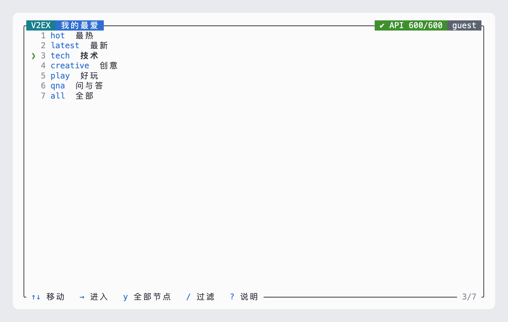
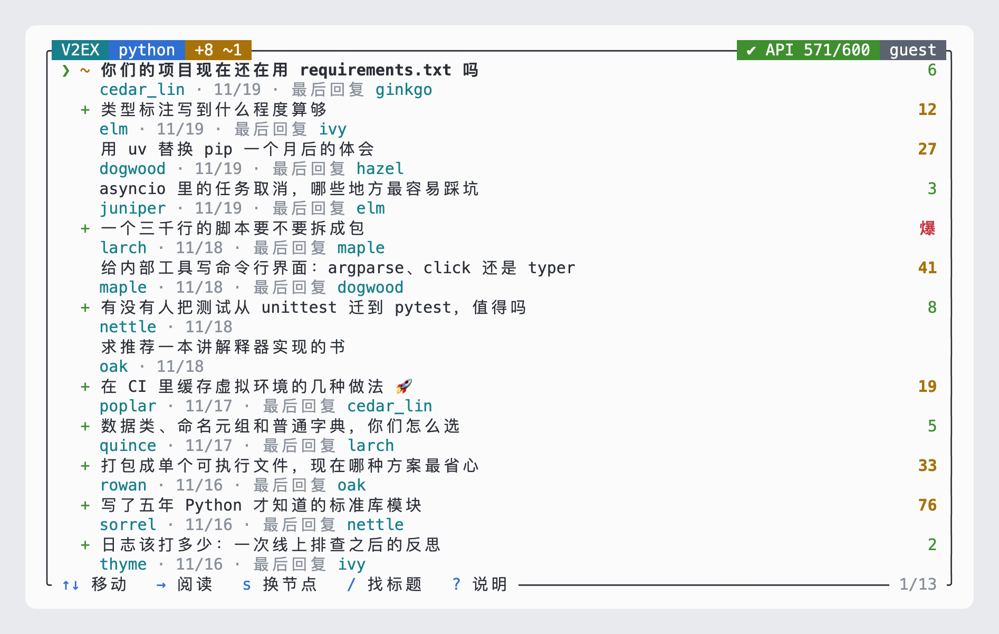
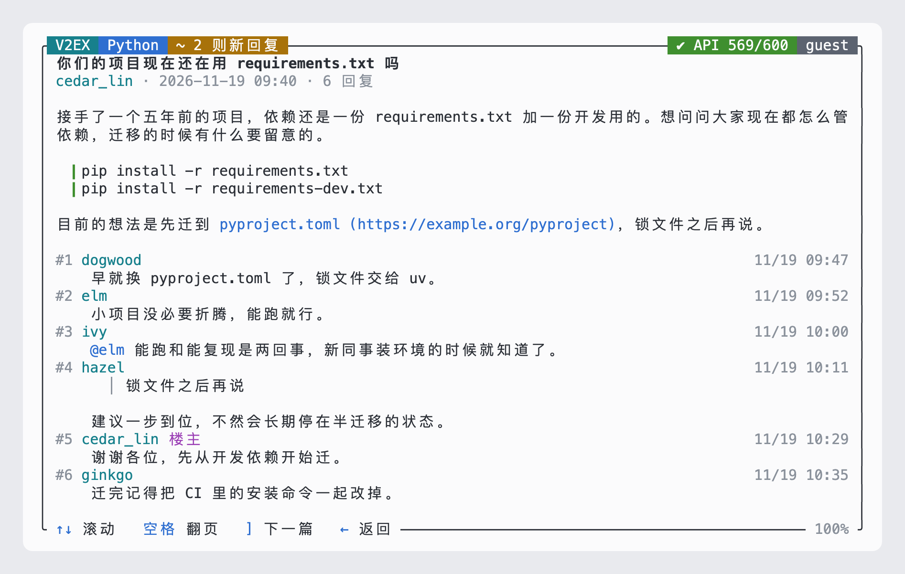

# v2exe

以 PTT 为灵感、在终端里运行的 V2EX 阅读器。

> 互动式界面与非互动式子命令都已可用。

## 截图

节点列表：

<picture>
  <source media="(prefers-color-scheme: dark)" srcset="docs/screenshots/nodes-dark.png">
  
</picture>

帖子列表：

<picture>
  <source media="(prefers-color-scheme: dark)" srcset="docs/screenshots/topics-dark.png">
  
</picture>

阅读页：

<picture>
  <source media="(prefers-color-scheme: dark)" srcset="docs/screenshots/reader-dark.png">
  
</picture>

图里的内容是示例。颜色跟随终端配色，实际观感以你的终端为准。

## 特性

- **不登录就能读。** 不需要 token：最热、最新、分 tab 列表、节点目录、节点的帖子、帖子正文与全部回复。
- **全键盘操作。** 方向键与 `h j k l`，输入编号直接跳到那一条或那一楼，列表内按标题或作者过滤。
- **列表占满终端。** 一屏能放多少就显示多少，不写死行数。
- **记得你读过什么。** 没读过的帖子和读过之后有新回复的帖子各有标记。
- **我的最爱。** 把常看的节点和 tab 放在启动画面，输入节点名可以直达任何节点。
- **跟随终端配色。** 只用终端自己的 16 色；状态栏是 powerlevel10k 式的彩色段落，显示所在位置、未读数和接口剩余额度。
- **按键提示常驻。** 每个画面的下边框写着当前可用的按键，`?` 打开完整按键表。
- **非互动式。** 不进界面，直接把列表或帖子输出成文本或 JSON，给脚本和 agent 用；同样的子命令加上 `-i`，就打开界面并停在那里。
- **守规矩。** 网页对游客挡住的节点，这里同样打不开，列表里也会滤掉；按站方的限流额度请求。
- **数据层可单独引用。** `v2ex-rs` 是不含界面代码的 Rust 库。

## 互动式

不带子命令运行 `v2exe` 就打开界面，启动画面是我的最爱。`?` 列出全部按键，`Ctrl-C` 退出。界面要在终端里运行，终端至少 40 列 × 8 行。

`--base-url`、`--proxy`、`--timeout`、`--no-color` 与配置文件对界面同样有效；`--json` 只用于非互动式。

## 非互动式

带子命令运行时，v2exe 把结果输出到 stdout 后退出。

| 指令 | 输出 |
|---|---|
| `v2exe hot` | 最热 |
| `v2exe latest` | 最新 |
| `v2exe tab <名字>` | 分 tab 列表，如 `tech`、`creative` |
| `v2exe node <节点名>` | 该节点的帖子列表 |
| `v2exe topic <编号或网址>` | 帖子正文与全部回复 |
| `v2exe nodes [关键词]` | 节点目录 |

| 选项 | 作用 |
|---|---|
| `--json` | 输出 JSON |
| `--limit <n>` | 列表最多输出 n 条 |
| `--no-replies` | `topic` 只输出正文 |
| `--no-color` | 关闭颜色 |
| `--base-url <网址>` | 站点地址，默认 `https://www.v2ex.com` |
| `--proxy <网址>` | 代理，支持 http、https、socks5；不指定时取环境变量 |
| `--timeout <秒>` | 请求超时，默认 10 秒 |
| `--version` | 输出版本号 |
| `-i`、`--interactive` | 不输出，改为打开界面并停在该位置，如 `v2exe -i topic 123456`；`v2exe -i nodes` 停在启动画面 |

```bash
# 看 python 节点最新的 10 个帖子
v2exe node python --limit 10

# 把一个帖子连同回复取成 JSON
v2exe topic 123456 --json

# 打开界面，直接进 python 节点
v2exe -i node python
```

列表的每一行以帖子编号开头，可以直接接给 `v2exe topic`。

## 配置

`--base-url`、`--proxy`、`--timeout` 也可以写进配置文件 `$XDG_CONFIG_HOME/v2exe/config.toml`；未设 `XDG_CONFIG_HOME` 时是 `~/.config/v2exe/config.toml`，macOS 同样如此。键是 `base_url`、`proxy`、`timeout`、`segment_edge`，命令行选项优先。文件不存在就用默认值，v2exe 不会创建它。

`segment_edge` 决定界面里色块的边缘，取 `plain`（默认）或 `powerline`；`powerline` 需要终端字体带 Powerline 符号。

```toml
base_url = "https://www.v2ex.com"
proxy = "socks5://127.0.0.1:1080"
timeout = 10
segment_edge = "plain"
```

界面把我的最爱和读过的帖子记在 `$XDG_STATE_HOME/v2exe/`（默认 `~/.local/state/v2exe/`），节点目录缓存在 `$XDG_CACHE_HOME/v2exe/`（默认 `~/.cache/v2exe/`），24 小时内不重新下载。这些目录用不了时界面照常运行，只是记录留不到下次。

## 安装

```bash
cargo install --path crates/v2exe
```

需要 Rust 1.88 或更新的版本，以及一个 C 编译器（TLS 后端要编译 C 代码）。只支持 Linux 与 macOS，从源码安装。

## 参考项目

- [seth-shi/go-v2ex](https://github.com/seth-shi/go-v2ex)
- [fuzy112/v2ex-tui](https://github.com/fuzy112/v2ex-tui)
- [synrise25/v2term](https://github.com/synrise25/v2term)
- [liaoliao666/v2ex](https://github.com/liaoliao666/v2ex)
- [ptt/pttbbs](https://github.com/ptt/pttbbs)
- [ptt/ptt-term](https://github.com/ptt/ptt-term)
- [romkatv/powerlevel10k](https://github.com/romkatv/powerlevel10k)
- [aome510/hackernews-TUI](https://github.com/aome510/hackernews-TUI)
- [pierreyoda/hncli](https://github.com/pierreyoda/hncli)
